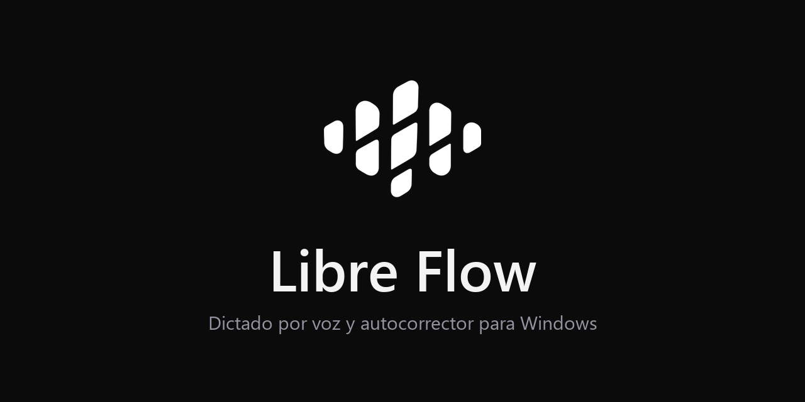

<p align="center"></p>

# Libre Flow

Dictado por voz y autocorrector para Windows, de código abierto.

Mantenés dos teclas, hablás, y el texto aparece donde está el cursor, en cualquier programa. Y cuando escribís con el teclado, corrige los errores al apretar espacio, como el autocorrector de un teléfono.

## Qué hace

- **Dictado en cualquier programa.** Mantené `Ctrl` + `Win`, hablá y soltá. El texto se escribe donde esté el cursor.
- **Manos libres.** Dos toques rápidos de `Ctrl` + `Win` dejan grabando sin sostener teclas.
- **Texto limpio.** Un modelo de lenguaje quita muletillas y repeticiones, ordena la puntuación y respeta cuando te corregís al hablar.
- **Autocorrector en vivo para el teclado físico.** `ohla` pasa a `hola`, `tambien` a `también`, `hol acomo estas` a `hola como estas`. Funciona sin internet y entiende el voseo rioplatense (`tenés`, `decime`).
- **Diccionario personal.** Nombres, marcas y términos que tienen que escribirse siempre igual.
- **Atajos de texto por voz.** Decís "mi mail" y escribe tu dirección completa.
- **Historial e Insights.** Todo lo dictado, cuánto tiempo ahorraste, tu velocidad y tus errores más repetidos.
- **Arranca con Windows** y vive como una barrita chica abajo en la pantalla y un ícono junto al reloj.

## Requisitos

- Windows 10 u 11 de 64 bits.
- Un micrófono.
- Una clave de API para transcribir. La de [Groq](https://console.groq.com/keys) es gratuita; también funciona con OpenAI o cualquier servicio compatible.

## Instalación con Claude Code

Es la forma más simple: Claude Code hace todo por vos.

1. Abrí [Claude Code](https://claude.com/claude-code) en tu computadora.
2. Pegale este mensaje:

   ```text
   Instalá Libre Flow en esta computadora. Cloná https://github.com/nodestudioai/libre-flow y seguí al pie de la letra el archivo INSTALAR.md del repositorio.
   ```

3. Si Windows pide permiso para instalar .NET, aceptá. En un par de minutos la app queda instalada y abierta.
4. Cargá tu clave, que es lo único que hacés a mano: entrá a [console.groq.com/keys](https://console.groq.com/keys), creá una cuenta gratis, tocá **Create API Key** y pegala en Libre Flow, en **Ajustes → Guardar clave**.

Listo. Mantené `Ctrl` + `Win`, decí una frase y soltá.

Para actualizar más adelante, decile a Claude Code: "actualizá Libre Flow".

## Instalación manual

Si preferís hacerlo vos, todo se hace desde **PowerShell** (buscalo en el menú Inicio). Copiá y pegá cada comando.

### 1. Instalar .NET 10

Es el componente de Microsoft con el que se compila la app. Si ya lo tenés, salteá este paso.

```powershell
winget install Microsoft.DotNet.SDK.10
```

Windows va a pedir permiso; aceptá.

### 2. Descargar Libre Flow

```powershell
git clone https://github.com/nodestudioai/libre-flow.git
```

Si no tenés Git, en esta página tocá **Code → Download ZIP**, descomprimilo y abrí PowerShell dentro de esa carpeta.

### 3. Instalar

```powershell
powershell -ExecutionPolicy Bypass -File libre-flow\scripts\install.ps1
```

Tarda cerca de un minuto. Compila la app, la instala para tu usuario, crea el acceso en el menú Inicio, la deja configurada para arrancar con Windows y la abre.

### 4. Cargar la clave

1. Entrá a [console.groq.com/keys](https://console.groq.com/keys) y creá una cuenta gratis.
2. Tocá **Create API Key** y copiá la clave.
3. En Libre Flow, andá a **Ajustes**, pegá la clave y tocá **Guardar clave**. Tiene que aparecer "Conexión correcta".

### 5. Probar

Abrí cualquier programa donde se pueda escribir, poné el cursor en una caja de texto, mantené `Ctrl` + `Win`, decí una frase y soltá.

Para probar el autocorrector, escribí `ohla` y apretá espacio.

## Atajos

| Atajo | Qué hace |
|---|---|
| Mantener `Ctrl` + `Win` | Dicta; al soltar escribe el texto |
| Dos toques rápidos de `Ctrl` + `Win` | Manos libres; otro `Ctrl` + `Win` termina |
| `Esc` | Cancela el dictado |
| `Shift` + `Alt` + `Z` | Pega el último dictado |
| `Shift` + `Alt` + `A` | Prende o apaga el autocorrector |
| `Backspace` justo después de una corrección | La deshace |

También podés hacer clic en el logo de la barrita para dictar en manos libres, y en **Aa** para prender o apagar el autocorrector.

## Cómo corrige el autocorrector

Actúa al apretar espacio, y también al apretar Enter si la línea tiene más de una palabra.

- Corrige errores de tipeo, espacios mal puestos, tildes que no admiten duda y la mayúscula al empezar una oración.
- No toca palabras válidas, aunque exista una versión con tilde (`como`, `esta`, `el`).
- No toca nada que tenga números o símbolos, palabras en MAYÚSCULAS, nombres propios, risas (`jajaja`) ni comandos comunes (`git`, `npm`).
- Se pausa solo en los campos de contraseña.
- Si una corrección no te sirve, apretá `Backspace` enseguida y la deshace. A la segunda vez con la misma palabra, la aprende y no la vuelve a corregir.
- Si te molesta en algún programa (un editor de código, una terminal), sumalo en **Autocorrector → Programas donde no corregir**.

## Privacidad

- **Lo que escribís con el teclado nunca sale de tu computadora.** El autocorrector trabaja con diccionarios locales.
- **El dictado sí usa internet.** El audio de cada dictado se envía al servicio de transcripción que configures, junto con las palabras de tu diccionario como pista. El texto transcripto se envía después a un modelo de lenguaje para limpiarlo. Libre Flow no tiene servidores propios: habla directo con el servicio que elijas, con tu clave.
- **Tus datos quedan en tu equipo**, en `%APPDATA%\LibreFlow`: historial, diccionario, ajustes y el audio de los últimos dictados (para poder reintentar si falla la conexión).
- **La clave se guarda cifrada** para tu usuario de Windows.
- No hay cuentas, telemetría ni publicidad.

## Problemas comunes

**No aparece el texto al dictar.** Revisá en Ajustes que la clave esté cargada y que "Probar conexión" funcione. En Historial queda cada intento con su error, y un botón para transcribirlo de nuevo.

**No se ve la barrita.** Fijate que esté activada en Ajustes → "Mostrar la barrita flotante". Con varios monitores, aparece en el que tiene la ventana activa.

**No funciona en algún programa.** En ventanas abiertas como administrador Windows no deja que la app escuche el teclado ni escriba. Es una protección del sistema.

**Windows o el antivirus desconfían de la app.** Libre Flow escucha el teclado para detectar el atajo y corregir, que es lo mismo que hace un programa malicioso. Por eso conviene instalarla desde este código, que podés revisar, y no desde binarios de terceros.

**El teclado se siente lento.** No debería. Si pasa, el archivo `%APPDATA%\LibreFlow\logs\app.log` anota cada vez que la app tarda en responder y qué estaba haciendo (nunca qué tecla apretaste). Abrí un reporte con esas líneas.

## Actualizar y desinstalar

Con Claude Code alcanza con pedírselo. A mano, para actualizar, desde la carpeta `libre-flow`:

```powershell
git pull
```

```powershell
powershell -ExecutionPolicy Bypass -File scripts\install.ps1
```

Para desinstalar:

```powershell
powershell -ExecutionPolicy Bypass -File scripts\uninstall.ps1
```

Eso quita el programa y conserva tus datos. Para borrar también el historial, el diccionario y los ajustes, agregá `-BorrarDatos` al final.

## Para quienes programan

- `src/LibreFlow.Core`: motor del autocorrector, base de datos, estadísticas y postproceso de texto. Sin interfaz.
- `src/LibreFlow`: la app de Windows (WPF), con el gancho de teclado, la grabación, el cliente de transcripción y el panel (HTML local en WebView2).
- `tests/LibreFlow.Tests`: pruebas unitarias. Se corren con `dotnet test`.
- `tests/e2e`: prueba de punta a punta contra un servidor local que imita la API.

Más detalle en [docs/ARQUITECTURA.md](docs/ARQUITECTURA.md).

## Licencia

El código está bajo licencia [MIT](LICENSE). Los diccionarios incluidos tienen sus propias licencias, detalladas en [THIRD-PARTY.md](THIRD-PARTY.md).

Libre Flow es un proyecto independiente y no está afiliado a ninguna aplicación comercial de dictado.
